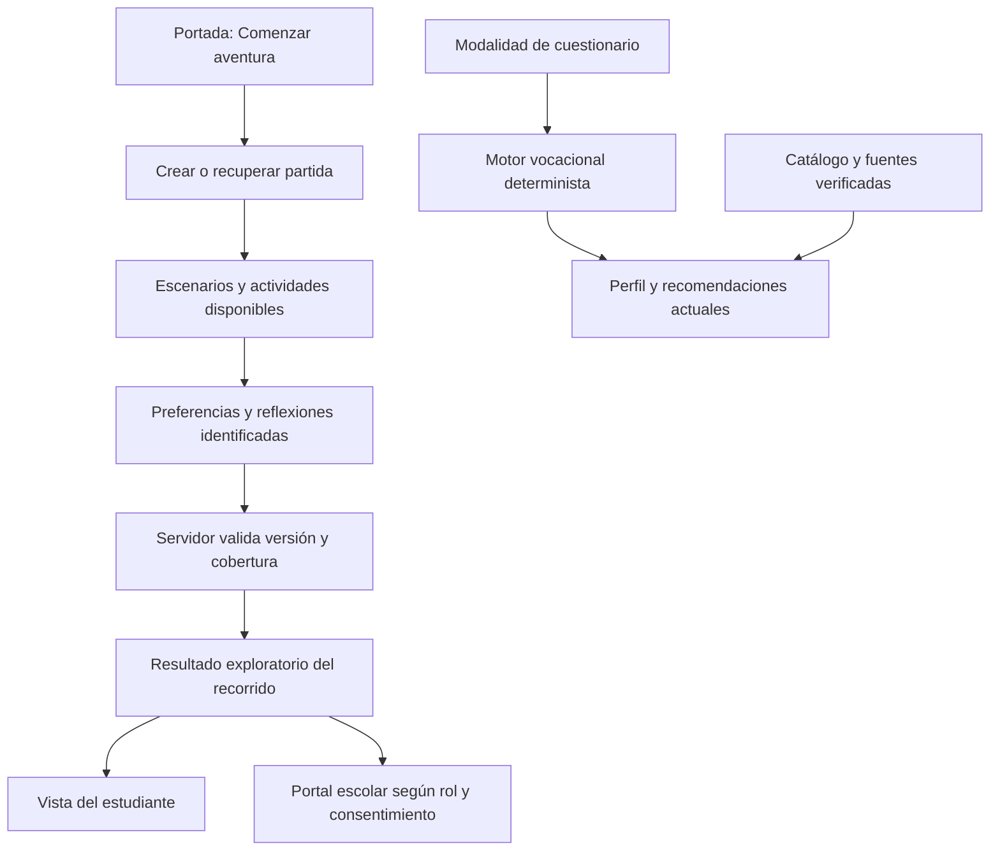

# Arquitectura del monolito modular de Chaski

Fecha: 2 de noviembre de 2026. Documento de implementación y evolución; distingue lo construido de lo pendiente. Sustituye como referencia de flujo a las descripciones históricas que sitúan obligatoriamente un cuestionario después del juego.

Verificación de cierre: `VERIFICACION_REFACTOR_2026_11_02.md`. La base configurada recibió también `LINK_USER_SESSIONS.sql` para incorporar las columnas opcionales de propietario ya declaradas en el esquema, conservando anónimos los registros anteriores. La clave local de firma se generó en `.env.local` ignorado por Git; el despliegue debe configurar su propia clave privada.

## Decisión de producto

La portada abre la aventura. Las interacciones evaluables se incorporan a escenarios, diálogos y minijuegos; finalizar el recorrido lleva a resultados. El cuestionario independiente puede conservarse como modalidad alternativa, no como segunda evaluación obligatoria.

El recorrido disponible es Plaza de Lima y colegio. Feria de talentos y siguientes escenarios todavía requieren diseño, implementación y pruebas. El resultado del recorrido disponible es **exploratorio y cualitativo**, no un diagnóstico psicométrico ni un ranking de profesiones. No se convierten los pesos narrativos actuales en porcentajes de compatibilidad con carreras.



## Decisión técnica

Se mantiene un único despliegue Next.js y PostgreSQL, con módulos. No se introducen microservicios ni una clase por operación. Funciones, tipos y contratos son suficientes cuando no hay necesidad de estado o polimorfismo.

La estructura se migra progresivamente; no se afirma que todo el repositorio esté convertido:

```text
src/
  app/                         Adaptadores HTTP y páginas Next.js
  modules/
    assessment/                Evaluación vocacional estructurada
      domain/                  Cálculo y validación sin framework ni BD
      application/             Casos de uso y puertos de persistencia
      infrastructure/          Adaptadores de catálogo y almacenamiento
    adventure/                 Evidencias y resultados de aventura
      domain/                  Contratos y reglas de finalización
      application/             Casos de uso
      infrastructure/          Repositorio, sesión y servicios externos
    chaski-ai/                 Validación, prompt y recuperación de hechos
    school-portal/             Consulta autorizada de exploraciones individuales
  game/                        Física, contenido y compatibilidad del juego actual
  components/game/             Presentación React/canvas existente
  db/                          Esquema y conexión Drizzle compartidos
  lib/                         Adaptadores y servicios anteriores, por migrar
```

Regla: presentación e infraestructura dependen de contratos de aplicación/dominio; el dominio no importa React, Next.js, Drizzle, Supabase ni SDK de IA. Un tipo de una actividad evaluable no debe depender del archivo de render de un escenario. Los adaptadores convierten sus datos al contrato del dominio.

## Contratos de aventura

- `POST /api/aventura/sesion`: crea o recupera una sesión; usa cookie firmada dedicada `chaski_adventure_session`. El navegador no elige un alumno ni un colegio mediante IDs del cuerpo.
- `POST /api/aventura/resultado`: recibe evidencia versionada, cinco conversaciones únicas y tres actividades únicas del recorrido disponible, con respuestas de Elena/Sofía cuando existen. Valida valores y cobertura; no acepta puntajes finales calculados por el cliente.
- `GET /api/aventura/resultado`: recupera el resultado con comprobación de propiedad de sesión e identidad cuando esté vinculado.
- `/aventura/resultados`: presenta las notas y reflexiones del recorrido. El contrato identifica `kind: adventure-exploration` y `scope: plaza-colegio`; no se hace pasar por el perfil del cuestionario.
- Persistencia: tabla existente `user_sessions`, evidencia en `answersPayload`, resultado versionado en `profileResult`, sin carreras recomendadas inventadas. Si falla la BD, se devuelve indisponibilidad y se conserva la partida local para reintentar, sin simular un guardado exitoso.

El guardado local del mundo sigue siendo una comodidad de reanudación. Su contenido puede manipularse: la validación del servidor demuestra forma, cobertura y coherencia de los datos enviados, no prueba por sí sola que el alumno haya recorrido físicamente cada punto del mapa. Una futura sincronización de eventos requerirá su propio protocolo de sesión, deduplicación y autorización.

## Evaluación y resultados

El motor estructurado se extrae del endpoint vocacional a dominio y aplicación. Debe rechazar respuestas incompletas, opciones que no pertenecen a su pregunta y repeticiones indebidas. La modalidad de formulario y una futura presentación gamificada calibrada deben usar el mismo motor y versión de instrumento.

Implementación de esa separación: `modules/assessment/domain/assessment.ts`, `application/completeAssessment.ts` e `infrastructure/assessmentRepository.ts`. El caso de uso recibe un `AssessmentRepository`; `/api/vocacional` conserva su contrato de preguntas/opciones y resultados para el frontend existente. La validación exige las 16 respuestas, cuatro misiones de cuatro preguntas con cuatro opciones, y rechaza opciones cruzadas o repetidas. El fallback de catálogo se toma completo para evitar mezclar parcialmente BD y datos locales.

Límites actuales del cuestionario: todavía no hay una versión de catálogo fijada entre GET y POST; cambiar el catálogo mientras se responde puede causar rechazo de validación. Su persistencia en `user_sessions` conserva el comportamiento heredado de mejor esfuerzo; la ruta de aventura, en cambio, requiere guardado confirmado antes de presentar su resultado persistido. No confundir ambos comportamientos ni prometer sincronización universal.

Separar:

| Dato | Significado permitido |
|---|---|
| Posición, velocidad, colisión | Estado del videojuego |
| Preferencia declarada | Interés expresado en una actividad |
| Intentos y solución del minijuego | Contexto de ejecución; no aptitud automáticamente |
| Reflexión del alumno | Motivación declarada, no inferencia clínica |
| Puntaje de instrumento | Resultado del instrumento y versión correspondiente |
| Notas académicas | Contexto escolar separado, sujeto a autorización |

No sumar notas, rendimiento en juego y preferencias en una fórmula nueva sin definición y validación. Mantener identificación de instrumento, versión, fecha, evidencias y algoritmo permite reproducir y explicar un resultado.

## Integración con el portal B2B

Ya existen entidades colegio/alumno, acceso de personal, consentimiento y vinculación de una sesión invitada mediante cookie verificada. El portal no debe recalcular resultados con una fórmula diferente.

La vista `/colegio/exploraciones` y su endpoint `GET /api/colegio/exploraciones` presentan evidencias exploratorias; hay enlace desde el dashboard. El módulo `school-portal` separa política de acceso (`domain/explorationAccess.ts`), caso de uso (`application/listExplorations.ts`) y lectura Drizzle (`infrastructure/explorationReader.ts`). No significa que todas las pantallas anteriores del portal estén migradas.

Las respuestas individuales se habilitan únicamente para `ADMIN` y `PSICOLOGO`. Director y tutor no reciben esos detalles por este endpoint. El lector toma `schoolId` de la identidad del personal validada, exige coincidencia de colegio entre sesión y alumno, alumno activo, consentimiento actual `GRANTED`, sesión sin expirar y tipo de perfil `adventure-exploration`. Se pagina por fecha con un máximo de veinte registros por respuesta y se impide caché compartida. Estos filtros deben mantenerse al crear exportaciones o nuevas vistas.

La matriz de capacidades en `src/lib/staffAuth.ts` diferencia administración, dirección, psicología y tutoría. Cada endpoint debe aplicar la capacidad concreta; la existencia de la matriz no demuestra que todas las pantallas la apliquen igual. El historial académico actual tiene restricciones adicionales por rol. No ampliar accesos para que una pantalla funcione.

## IA y catálogo: siguiente separación

El acompañamiento lateral del juego todavía incluye textos programados. `/api/chat` es una integración diferente y no debe recibir como hechos confiables puntajes o identidad proporcionados libremente por el navegador.

Se separaron la validación de entrada en `modules/chaski-ai/domain/chatRequest.ts`, la construcción del prompt en `application/buildPrompt.ts` y la recuperación de contexto en `infrastructure/careerContext.ts`. El contrato de entrada restringe mensajes a roles `user`/`assistant`, limita cantidades y longitud, y exige que el último mensaje sea del usuario. La ruta HTTP adapta la solicitud y selecciona el proveedor.

La IA explica evidencias y datos con procedencia; no decide el puntaje oficial ni inventa motivaciones. Los datos de carreras, costos y sedes deben tener procedencia y vigencia verificables. Un prompt de grounding no garantiza ausencia de alucinaciones. La integración contextual del acompañante del juego y la trazabilidad completa de cada afirmación siguen requiriendo pruebas y evolución.

## Seguridad de sesiones: intervención verificada

Se confirmó en la BD remota que `user_sessions` tenía RLS activado pero conservaba políticas permisivas y acceso público. Se aplicó el SQL operativo documentado en `docs/architecture/HARDEN_USER_SESSIONS.sql`: revocación de privilegios de `PUBLIC`, `anon` y `authenticated`, más una política restrictiva que deniega esas rutas de Data API. La aplicación sigue accediendo mediante los endpoints de servidor y Drizzle con autorización propia.

La verificación posterior confirmó lectura anónima denegada, actualización de `authenticated` denegada e inserción del rol de servidor habilitada. No se borraron filas. Esto acredita ese endurecimiento concreto, no la seguridad total de todas las tablas o endpoints.

El CLI de Supabase no estaba instalado: el SQL quedó como registro operativo auditado, **no como una nueva migración canónica**. Falta reconciliar su aplicación con el historial de migraciones antes de recrear o desplegar otra BD. No ejecutar el antiguo SQL público de sesiones para revertirlo accidentalmente.

## Verificación continua

`.github/workflows/quality.yml` ejecuta instalación reproducible con lockfile, Vitest, tipos, lint dirigido a los módulos y rutas migrados, y build. `src/__tests__/architecture.test.ts` comprueba límites de dependencias. La ejecución local y la ejecución real en GitHub Actions son evidencias distintas; no afirmar que CI pasó hasta ver ese run. No se documenta aquí un conteo final de pruebas mientras los cambios se integran.

## Deuda y pasos pendientes

1. Unificar mecanismos repetidos de canvas, entrada, física, carga y transiciones; cada escenario aportará datos y actividades. Mantener el mapa aprobado mientras se prueba cada extracción.
2. Extender las vistas B2B solo cuando corresponda, conservando la separación entre evidencia exploratoria y perfil estructurado, y probar aislamiento entre colegios y cambios de consentimiento.
3. Completar la auditoría de políticas RLS y grants de las demás tablas. Reconciliar el endurecimiento remoto de `user_sessions` con la historia canónica de migraciones.
4. Sustituir límites de peticiones en memoria si se despliegan varias instancias; definir cuotas por sesión y presupuesto del proveedor de IA.
5. Consolidar la secuencia de migraciones antes de mover SQL histórico. No ejecutar scripts antiguos indiscriminadamente.
6. Completar pruebas HTTP de propiedad, aislamiento entre colegios, reintentos y fallos de infraestructura; mantener pruebas de dominio y recorrido UI. Ejecutar y revisar CI en GitHub antes de publicar.
7. Calibrar las interacciones evaluables de los próximos escenarios para llegar a un perfil final defendible; no declarar validación psicométrica porque compilan los tipos.

## Criterio para futuros cambios

Un caso de uso tiene una razón para cambiar; una ruta HTTP adapta entrada/salida; un repositorio almacena; un componente muestra e interactúa. Extraer responsabilidades por estos límites, no por un número arbitrario de líneas. Los scripts diagnósticos y las imágenes de referencia se inventarían por separado del runtime: ver `INVENTARIO_DEPURACION.md`.

## Contenido exploratorio versionado

Los catálogos puros `adventure/domain/narrativeContent.ts` y `schoolChallengeContent.ts` definen las situaciones editoriales y verificaciones didácticas. UI y resumen del servidor comparten notas por versión. Las respuestas sin versión conservan legacy-v1; las nuevas registran adventure-v2 por evidencia. La revisión científica y los límites están en [Investigación de contenido](../game/INVESTIGACION_CONTENIDO_AVENTURA_V2.md). No se modificó el instrumento formal del cuestionario ni se generaron baremos nuevos.
